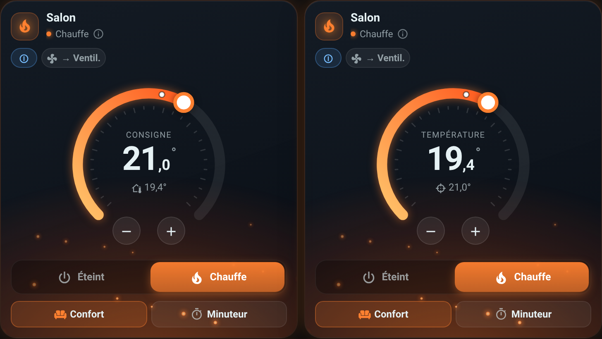
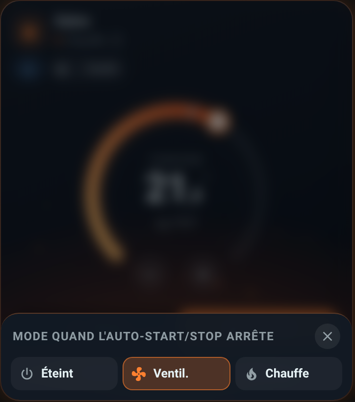
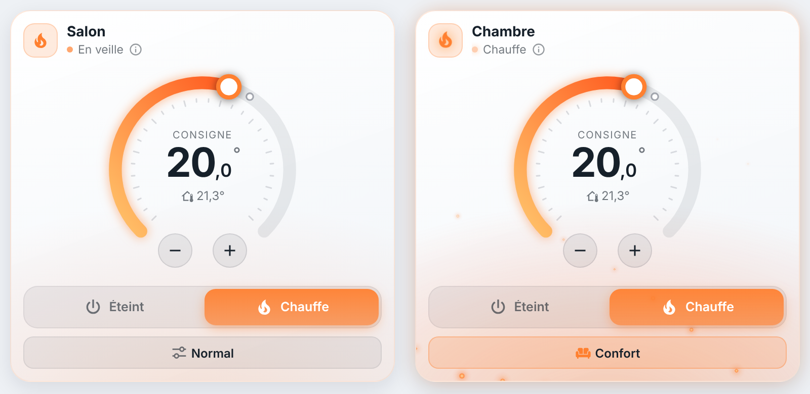
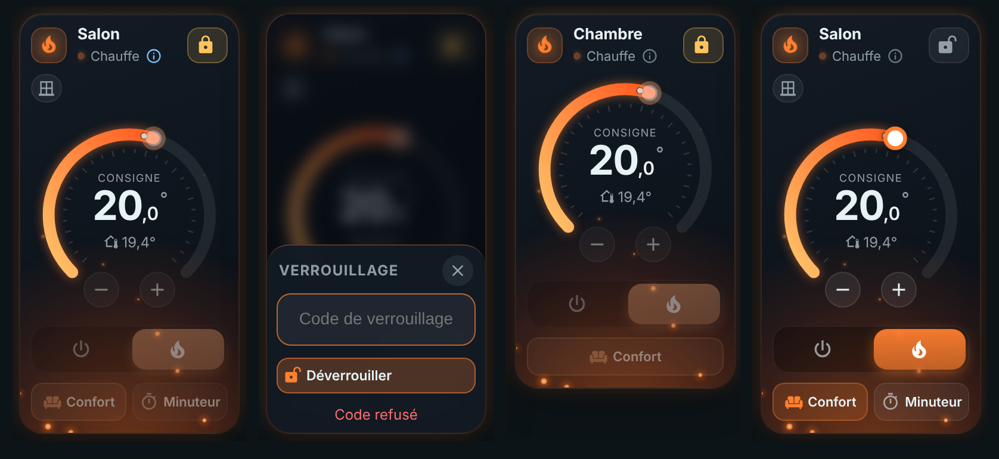

# 🌡️ HOLM Climate Card

[](https://hacs.xyz/)


[🇫🇷 Français](README.md) · 🇬🇧 English

**A compact, lively climate / heating card: you see at once whether it is heating or cooling, and you set the target in one gesture.**

HOLM Climate Card replaces the thermostat card for your `climate` entities (air conditioners, heat pumps, smart heaters…). It fits **two side by side on a phone**, spreads out nicely at **full width**, and its mood changes with what the device is doing: **embers** rising while heating, **snowflakes** while cooling, a grey mist breathing when off.

> ✨ **Zero YAML.** Add it from the card picker, choose your device: done.

### At a glance

- 🔥❄️ **Mood follows the device**: warm glow and embers when heating, cool glow and snowflakes when cooling, animations **only when the device is actually heating or cooling** (otherwise a calm glow).
- 🎯 **270° setpoint dial**: drag the handle, or adjust by half a degree with − / +. The current temperature is marked on the dial.
- 🔘 **Mode chips**: Off / Heat / Cool / **Fan** (if the device can ventilate), plus the current mode if different (heat / cool, dry).
- 🌬️ **Fan mode**: sea-green colour, air streaks across the card; without a temperature setpoint, the dial and − / + buttons set the **fan speed**.
- 🌀 **Fan, preset, vertical and horizontal swing**: compact chips that open a choice panel. Only the options the device knows are offered.
- ⚡ **Instant response**: the screen changes right away, without waiting for the device (ideal with cloud-controlled air conditioners, often slow to respond).
- 📱 **Two sizes**: compact (2 cards per row on mobile) or wide (dial on the left, controls on the right), automatically depending on the space available.
- 📏 **Compact view** (`layout: compact`): no dial and very low — the − / + setpoint sits next to the name, modes and options just below; at full width everything fits on **a single line**.
- 🌡️ **Sensor of your choice** and **graph**: the temperature can come from another sensor; tapping it opens the history (24 h by default, 6 h / 48 h / 7 d) with the setpoint and heating / cooling periods.
- 🔒 **Min / max setpoints**: limit the dial and buttons (e.g. 18 to 23 °C).
- 🏷️ **Status badges** (`badges`): up to 4 entities shown under the name (window, presence, humidity…), for any thermostat.
- 🧠 **Versatile Thermostat option** (`vtherm: true`): open window (bypass on tap), presence, motion, load shedding, safety, heating failure, **inhibition**, **auto-start/stop**, lock, reason for stopping, **preset timer** with countdown, heating rate and outdoor temperature (your choice). Off by default: the card stays simple.
- 🔐 **Locking**: the Versatile Thermostat lock is respected (greyed controls, padlock to unlock, code if needed), and an **anti-mistake** option locks the controls of any thermostat against accidental changes while scrolling.
- 🌍 **8 languages**: English, French, German, Spanish, Italian, Dutch, Portuguese and Polish, following your Home Assistant profile language (English for other languages), or forced with the `language` option.
- 👆 Tapping the name opens the device's more-info in Home Assistant; tapping the temperature opens its history.

| Two side by side (heating / cooling) | Full width |
|---|---|
|  |  |

*Screenshots in French — the card follows the language of your Home Assistant profile.*

**Compact view** (`layout: compact`)


**Fan mode** (the dial sets the speed)


| Choice panel (fan) | Temperature history |
|---|---|
|  |  |

### 🆕 What's new in 1.8.1

- 🔒 **Security**: names and values coming from entities (badges, “Why this state?” sheet, fan, presets, swing, timed preset) are now escaped before being displayed. A name or attribute containing `<` or `"` is shown as is and can no longer run code.

### What's new in 1.8.0

- 🌡️ **Measured temperature in large** ([#14](https://github.com/kaaribou/climate-card-holm/issues/14)): new option `main_value: current`. In the centre of the dial, the room temperature in large and the setpoint below (🎯). While adjusting, the setpoint becomes large again for a few seconds. See [The value in the centre of the dial](#the-value-in-the-centre-of-the-dial).
- 🔁 **Mode on automatic stop** ([#13](https://github.com/kaaribou/climate-card-holm/issues/13), Versatile Thermostat): next to the auto-start/stop badge, a “→ Off”, “→ Fan”… badge shows the mode the VTherm switches to when auto-start/stop stops it; a tap opens the choice.

| Setpoint (default) and measured temperature in the centre | Mode on automatic stop |
|---|---|
|  |  |

*(screenshots in French)*

### What's new in 1.7.0

- 🌗 **Light theme** ([#12](https://github.com/kaaribou/climate-card-holm/issues/12)): the card follows Home Assistant's light or dark mode (`theme` option: `auto`, `dark` or `light`), panels and graph included.
- 🙈 **Hidden presets** ([#10](https://github.com/kaaribou/climate-card-holm/issues/10)): `hidden_presets` option, e.g. `none` to stop offering the **Normal** mode. If the thermostat switches to it by itself, the card still shows it.
- 💤 **"Idle" instead of "Off"** ([#11](https://github.com/kaaribou/climate-card-holm/issues/11)) when the thermostat is in heat mode but not heating (setpoint reached).



### What's new in 1.6.0

- 🌍 **The card speaks 8 languages**: English, French, German, Spanish, Italian, Dutch, Portuguese and Polish, editor and graph included. New: Spanish, Italian, Dutch, Portuguese and Polish, on top of French, German and English. It follows the language of your Home Assistant profile; the `language` option lets you force one.
- For a language not translated yet, the card now shows in English (previously in French).

### What's new in 1.5.0

**Locking**: thermostat locked by Versatile Thermostat, code entry, the card's anti-mistake lock, and unlocked



- 🔐 **Versatile Thermostat lock** ([#7](https://github.com/kaaribou/climate-card-holm/issues/7)): when the VTherm is locked, the dial, buttons, modes and presets are greyed out; the padlock unlocks (with the code if there is one) and locks again.
- 🛡️ **Anti-mistake lock** (`lock: true`) for any thermostat: tapping the padlock unlocks the controls for a few seconds (`lock_delay`, 30 s by default). While locked, the dial lets the page scroll.
- 🌍 **German and English translations** ([#8](https://github.com/kaaribou/climate-card-holm/pull/8), thanks to [@hco](https://github.com/hco)).
- 🐛 The card works in **expander-card / Streamline** ([#9](https://github.com/kaaribou/climate-card-holm/issues/9)).

### What's new in 1.4.0

**Why this state?** (Versatile Thermostat) and panels that always fit in the card, even at half width on mobile


### What's new in 1.3.0

**Versatile Thermostat**: manual stop, inhibition, auto-start/stop (active badges on tap) and, at full width, badges to the right of the name


### What's new in 1.2.0

**Versatile Thermostat option**: normal state, open window, preset timer


**Status badges**, here in compact view (VTherm on top, a classic thermostat with a window and humidity below)


---

## Installation

### With HACS (recommended)

1. Open **HACS** and search for **HOLM Climate Card**.
2. Open the card → **Download**.
3. Reload the page (Ctrl + F5).

> If the card does not show up in the search yet: HACS → ⋮ menu → **Custom repositories**, add `https://github.com/kaaribou/climate-card-holm`, category **Dashboard** (*Plugin*), then start again at step 1.

### Manually

1. Copy `dist/holm-climate-card.js` to `config/www/community/holm-climate-card/`.
2. **Settings → Dashboards → ⋮ → Resources → Add**: `/local/community/holm-climate-card/holm-climate-card.js`, type **JavaScript module**.
3. Reload the page.

---

## Usage

Add the **HOLM Climate** card from the card picker and choose your device.

```yaml
type: custom:holm-climate-card
entity: climate.living_room
```

In a sections dashboard, the card takes half the width by default: **two cards per row**. Widen it (12 columns) for the full-width layout.

---

## Options

| Option | Description | Default |
|---|---|---|
| `entity` | `climate` entity (**required**) | — |
| `language` | Language: `fr`, `en`, `de`, `es`, `it`, `nl`, `pt`, `pl` | the profile's |
| `name` | Display name | device name |
| `icon` | Icon when the device is off | `mdi:air-conditioner` |
| `show_fan` | **Fan** chip | `true` |
| `show_preset` | **Preset** chip (boost, away, eco…) | `true` |
| `show_swing` | Vertical and horizontal **Swing** chips | `true` |
| `layout` | `full` (with the dial) or `compact` (wide, without the dial) | `full` |
| `main_value` | Large value in the centre of the dial: `target` (setpoint, reading below) or `current` (measured temperature, setpoint below) | `target` |
| `theme` | `auto` (follows Home Assistant's light / dark mode), `dark` or `light` | `auto` |
| `hidden_presets` | Presets not to offer, e.g. `[none]` to hide **Normal** | — |
| `min_temp` / `max_temp` | Minimum / maximum allowed setpoint (within the device's limits) | device limits |
| `temperature_sensor` | Temperature sensor shown (otherwise the device's own) | — |
| `graph_hours` | Graph duration when opened (hours) | `24` |
| `badges` | List of entities shown as badges (4 at most) | — |
| `lock` | Anti-mistake lock: controls blocked until the padlock is tapped | `false` |
| `lock_delay` | Unlock duration (seconds) | `30` |
| `vtherm` | Versatile Thermostat features (offered in the editor only for a VTherm entity) | `false` |
| `vtherm_info` | Information below the controls: `heat` (heating rate), `power` (average power), `ext` (outdoor temperature), `bar` (heating bar) | all |
| `vtherm_inhibition_bypass` | Inhibition bypass switch (provided by your inhibition plugin) | — |
| `vtherm_auto_start_stop` | The VTherm's “Enable auto start/stop” switch | found automatically |
| `vtherm_auto_start_stop_mode` | The VTherm's auto-start/stop “stop mode” select (`select.…_auto_start_stop_…`) | found automatically |

```yaml
type: custom:holm-climate-card
entity: climate.bedroom
name: Bedroom
show_swing: false
```

Compact view with a sensor and a setpoint range:

```yaml
type: custom:holm-climate-card
entity: climate.office
layout: compact
temperature_sensor: sensor.office_temperature
min_temp: 18
max_temp: 24
```

Tapping the **current temperature** opens the history: temperature (or sensor), dotted setpoint, heating and cooling periods, minimum / maximum / average and running time.

### The value in the centre of the dial

By default (`main_value: target`), the large number in the centre is the **setpoint** and the measured temperature is small below it (🏠 19.4°, a tap opens the history).

With `main_value: current` (editor: **Big value in the centre of the dial** → *Measured temperature*):

- the large number is the **room temperature**, under the “Temperature” label;
- the setpoint is below, with the 🎯 icon (a tap still opens the history);
- **while adjusting**, by dragging the dial or with + and −, the setpoint becomes large again so you see the value chosen, then the reading comes back 2 to 3 seconds later;
- the dot on the dial stays the measured temperature, the round handle the setpoint;
- in fan-only mode, or if the device has no setpoint or no reading, the card keeps the usual display.

The compact view already shows both side by side: the option does not change it.

```yaml
type: custom:holm-climate-card
entity: climate.living_room
main_value: current
```

### Locking

```yaml
type: custom:holm-climate-card
entity: climate.bedroom
lock: true
lock_delay: 20
```

The padlock appears in the header. While locked, the card stays readable but its controls are greyed out; tapping a control shakes the padlock. Tapping the padlock unlocks the card for `lock_delay` seconds (countdown shown), a second tap locks it again straight away.

With a VTherm whose locking is configured, the padlock follows **the Versatile Thermostat lock** (see below), even without the `lock` option.

### Status badges

```yaml
type: custom:holm-climate-card
entity: climate.living_room
badges:
  - binary_sensor.living_room_window
  - sensor.living_room_humidity
```

A numeric value shows with its unit (blue); an active sensor (window open, presence…) shows in orange with its name; inactive, only the icon remains. Tapping opens the entity's more-info.

---

## Versatile Thermostat

For thermostats created with [Versatile Thermostat](https://github.com/jmcollin78/versatile_thermostat) (VTherm), tick **Versatile Thermostat features** in the editor (`vtherm: true`). The option only shows if the chosen entity is a VTherm; without it, the card stays exactly the same.

```yaml
type: custom:holm-climate-card
entity: climate.living_room_vtherm
vtherm: true
```

| What the card shows | Detail |
|---|---|
| 🪟 **Window** | Window badge: **a tap turns the open window detection bypass on or off** (“Window open” → “Window ignored”). |
| ⏸️ **Inhibition** | “Inhibited” when an inhibition plugin suspends device control. If the bypass switch is set (`vtherm_inhibition_bypass`), tapping the badge turns the bypass on or off. |
| 🔁 **Auto-start/stop** | “Auto stop” badge when the VTherm is stopped by auto-start/stop; a tap turns the feature on or off. |
| ➡️ **Mode on automatic stop** | When auto-start/stop is on, the badge next to it (“→ Off”, “→ Fan”…) shows the mode the VTherm switches to on automatic stop (set in VTherm: off by default, or fan only, or another mode of the device). A tap opens the choice panel with the current mode highlighted; it turns orange while the VTherm is actually stopped. The select is found automatically on the thermostat's device (`vtherm_auto_start_stop_mode` to set it by hand); without it, nothing is shown. |
| 🏠 **Presence / motion** | “Away” when the away setpoint applies, motion detected in the room. |
| ⚡ **Load shedding** | Red badge and red card border when heating is shed. |
| 🛡️ **Safety** | Silent sensor: safety heating, shown in red. |
| 🩺 **Heating failure** | Heating or cooling failure detected, shown in red. |
| 🔒 **Lock** | When VTherm locking blocks users, the controls are greyed out. The header padlock unlocks (`versatile_thermostat.unlock`, with the **code** if configured) or locks again. VTherm's automatic relock is respected. |
| 💬 **Reason** | Under the name, in your language: why the thermostat is stopped (window, auto-start/stop, inhibition, central mode…), or the timer countdown. |
| ℹ️ **Why this state?** | Tapping the status line (ⓘ icon) opens the full list of VTherm messages, translated: reason for stopping, setpoint applied (window, load shedding, absence, central mode…), unavailable device, initialisation, bypass, failures. |
| ⏱️ **Timer** | **Timer** chip: choose a preset (boost, comfort…) and a duration (30 min to 4 h); the countdown shows and the previous preset comes back on its own. **Cancel** at any time. |
| 🔥 **Heating** | Heating rate of the current cycle, average power, outdoor temperature and heating bar — each one optional (`vtherm_info`). |

At full width, the badges sit to the right of the name to save height. Only the elements configured in your VTherm are shown. VTherm's Frost protection, Load shedding and Safety presets have their own icon and translated name.

> These features were developed from the Versatile Thermostat documentation and tested with simulated states. Feedback from VTherm users is welcome in the [issues](https://github.com/kaaribou/climate-card-holm/issues).

---

## FAQ / troubleshooting

| Problem | Solution |
|---|---|
| A chip doesn't show | The device doesn't offer that option to Home Assistant (e.g. no fan modes on a heater). |
| Animations don't start | They only run when the device **is actually heating or cooling** (`hvac_action`). On standby, the glow stays calm. They are also turned off if your system asks to reduce motion. |
| The setpoint jumps back | The device didn't accept the value (outside the min / max range): the card shows the real value again after about twenty seconds. |
| The Versatile Thermostat option doesn't show | The entity isn't recognised as a VTherm (`is_window_configured`, `specific_states`… attributes missing). You can still add `vtherm: true` in YAML. |
| The card stays on “Loading…” in expander-card | Fixed in 1.5.0: update the card. |
| The card is not in my language | It follows your Home Assistant profile language (8 languages, English for others); the `language` option lets you force one. Open an issue to suggest a translation. |
| The new version doesn't show | Clear the cache (Ctrl + F5, or “Reload resources” in the mobile app). |

---

## Say thanks?

Like the card? You can buy me a beer 🍺

[](https://paypal.me/kaaribou)

---

## License

Code: **MIT** license — © kaaribou. See the [CHANGELOG](CHANGELOG.md) (in French).

Part of **HOLM — Home Orchestration & Living Management**: smart management and orchestration of the home.

Other projects: [Carburant HOLM](https://github.com/kaaribou/carburant-holm) · [Climat HOLM](https://github.com/kaaribou/climat-holm) · [Volets HOLM](https://github.com/kaaribou/volets-holm) · [HOLM HP/HC](https://github.com/kaaribou/holm-tarif) · [HOLM Lektrico](https://github.com/kaaribou/lektrico-holm) · [HOLM LaMetric](https://github.com/kaaribou/lametric-holm) · [HOLM My Menu](https://github.com/kaaribou/holm-mymenu) · [HOLM Cars](https://github.com/kaaribou/holm-cars) · [HOLM GitHub](https://github.com/kaaribou/github-holm) · [HOLM Navbar Card](https://github.com/kaaribou/holm-navbar-card) · [HOLM Music Card](https://github.com/kaaribou/holm-music-card) · [HOLM Energy Cards](https://github.com/kaaribou/holm-energy-cards) · [HOLM Power Flow Card](https://github.com/kaaribou/holm-power-flow-card) · [HOLM Ecojoko Card](https://github.com/kaaribou/holm-ecojoko-card) · [HOLM Runtime Card](https://github.com/kaaribou/holm-runtime-card) · [HOLM Covers Card](https://github.com/kaaribou/holm-covers-card) · [HOLM Floor Card](https://github.com/kaaribou/holm-floor-card) · [HOLM Radiator Card](https://github.com/kaaribou/holm-radiator-card) · [HOLM Security Card](https://github.com/kaaribou/holm-security-card) · [HOLM Sentinel Card](https://github.com/kaaribou/holm-sentinel-card) · [HOLM Recordings Card](https://github.com/kaaribou/holm-recordings-card) · [HOLM Smoke Card](https://github.com/kaaribou/holm-smoke-card) · [HOLM Family Card](https://github.com/kaaribou/holm-family-card) · [HOLM Govee Light Card](https://github.com/kaaribou/holm-govee-light-card) · [HOLM Leapmotor Card](https://github.com/kaaribou/holm-leapmotor-card).
