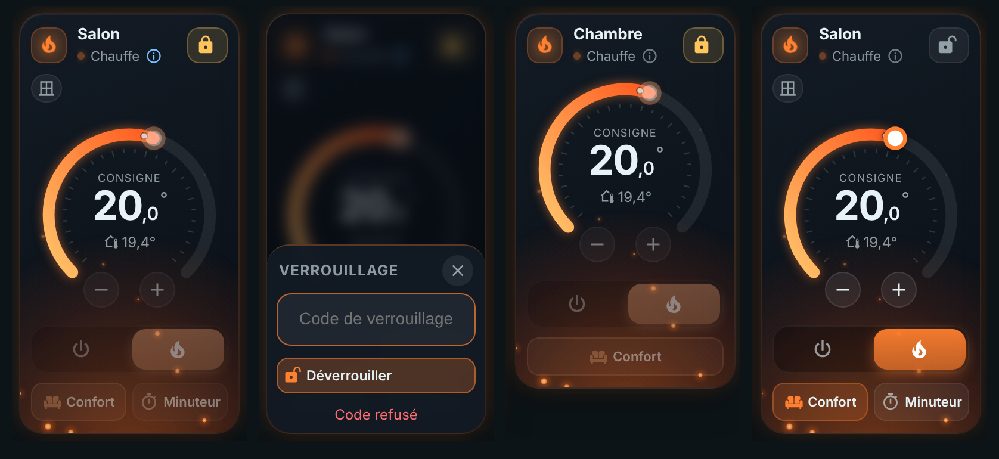

# 🌡️ HOLM Climate Card

[](https://hacs.xyz/)


**Une carte clim / chauffage compacte et vivante : on voit tout de suite si ça chauffe, si ça refroidit, et on règle la consigne d'un geste.**

HOLM Climate Card remplace la carte thermostat pour vos entités `climate` (climatiseurs, pompes à chaleur, radiateurs connectés…). Elle tient à **deux côte à côte sur un téléphone**, s'étale joliment en **pleine largeur**, et son ambiance change selon ce que fait l'appareil : **braises** qui montent quand il chauffe, **flocons** quand il refroidit, brume grise qui respire quand il est éteint.

> ✨ **Zéro YAML.** On l'ajoute depuis le sélecteur de cartes, on choisit son appareil : c'est prêt.

### En bref

- 🔥❄️ **Ambiance selon l'usage** : lueur chaude et braises en chauffage, lueur froide et flocons en clim, animations **seulement quand l'appareil chauffe ou refroidit réellement** (sinon lueur apaisée).
- 🎯 **Roue de consigne 270°** : on fait glisser le curseur, ou on ajuste au demi-degré avec − / +. La température actuelle est repérée sur la roue.
- 🔘 **Modes en pastilles** : Éteint / Chauffage / Clim / **Ventilation** (si l'appareil sait ventiler), et le mode en cours s'il est différent (chaud / froid, déshumidification).
- 🌬️ **Mode ventilation** : couleur vert d'eau, filets d'air qui traversent la carte ; sans consigne de température, la roue et les boutons − / + règlent la **vitesse de ventilation**.
- 🌀 **Ventilation, préréglage, oscillation** verticale et horizontale : des puces compactes qui ouvrent un volet de choix. Seules les options que l'appareil connaît sont proposées.
- ⚡ **Réponse immédiate** : l'écran change tout de suite, sans attendre l'appareil (idéal avec les clims pilotées par le cloud, souvent lentes à répondre).
- 📱 **Deux tailles** : compacte (2 cartes par ligne sur mobile) ou large (roue à gauche, commandes à droite), automatiquement selon la place disponible.
- 📏 **Vue compacte** (`layout: compact`) : sans la roue et très basse — la consigne − / + est au niveau du nom, les modes et options juste dessous ; en pleine largeur tout tient sur **une seule ligne**. S'adapte à la place disponible (options en icônes sur les cartes très étroites).
- 🌡️ **Sonde au choix** et **graphique** : la température peut venir d'un autre capteur ; un toucher dessus ouvre l'historique (24 h par défaut, 6 h / 48 h / 7 j) avec la consigne et les périodes de chauffe / clim.
- 🔒 **Consignes mini / maxi** : bornez la roue et les boutons (ex. 18 à 23 °C).
- 🏷️ **Pastilles d'état** (`badges`) : jusqu'à 4 entités affichées sous le nom (fenêtre, présence, humidité…), pour n'importe quel thermostat.
- 🧠 **Option Versatile Thermostat** (`vtherm: true`) : fenêtre ouverte (bypass au toucher), présence, mouvement, délestage, sécurité, défaut de chauffe, **inhibition**, **auto-start/stop**, verrou, raison de l'arrêt, **minuteur de préréglage** avec décompte, taux de chauffe et température extérieure (au choix). Désactivée par défaut : la carte reste simple.
- 🔐 **Verrouillage** : le verrou de Versatile Thermostat est respecté (commandes grisées, cadenas pour déverrouiller, code si besoin), et une option **anti-erreur** verrouille les commandes de n'importe quel thermostat contre les changements involontaires en faisant défiler la page.
- 🌍 **Français, allemand, anglais** selon la langue de Home Assistant (français par défaut).
- 👆 Un toucher sur le nom ouvre la fiche de l'appareil dans Home Assistant ; un toucher sur la température ouvre son historique.

| Deux côte à côte (chauffage / clim) | Pleine largeur |
|---|---|
|  |  |

**Vue compacte** (`layout: compact`)


**Mode ventilation** (la roue règle la vitesse)


| Volet de choix (ventilation) | Historique de la température |
|---|---|
|  |  |

### 🆕 Nouveautés de la 1.5.0

**Verrouillage** : thermostat verrouillé par Versatile Thermostat, saisie du code, verrou anti-erreur de la carte et déverrouillé



- 🔐 **Verrou de Versatile Thermostat** ([#7](https://github.com/kaaribou/climate-card-holm/issues/7)) : quand le VTherm est verrouillé, la roue, les boutons, les modes et les préréglages sont grisés ; le cadenas déverrouille (avec le code s'il y en a un) et reverrouille.
- 🛡️ **Verrou anti-erreur** (`lock: true`) pour tout thermostat : un toucher sur le cadenas débloque les commandes quelques secondes (`lock_delay`, 30 s par défaut). Verrouillée, la roue laisse défiler la page.
- 🌍 **Traductions allemand et anglais** ([#8](https://github.com/kaaribou/climate-card-holm/pull/8), merci à [@hco](https://github.com/hco)) : la carte suit la langue de Home Assistant, le français reste la langue par défaut.
- 🐛 La carte fonctionne dans **expander-card / Streamline** ([#9](https://github.com/kaaribou/climate-card-holm/issues/9)).

### Nouveautés de la 1.4.0

**Pourquoi cet état ?** (Versatile Thermostat) et volets qui tiennent toujours dans la carte, même en demi-largeur sur mobile


### Nouveautés de la 1.3.0

**Versatile Thermostat** : arrêt manuel, inhibition, auto-start/stop (pastilles actives au toucher) et, en pleine largeur, pastilles à droite du nom


### Nouveautés de la 1.2.0

**Option Versatile Thermostat** : état normal, fenêtre ouverte, minuteur de préréglage


**Pastilles d'état**, ici en vue compacte (VTherm en haut, thermostat classique avec une fenêtre et l'humidité en bas)


---

## Installation

### Avec HACS (recommandé)

1. HACS → menu ⋮ → **Dépôts personnalisés**.
2. Ajoutez `https://github.com/kaaribou/climate-card-holm`, catégorie **Tableau de bord** (*Dashboard / Plugin*).
3. Recherchez **HOLM Climate Card** → **Télécharger**.
4. Rechargez la page (Ctrl + F5).

### Manuellement

1. Copiez `dist/holm-climate-card.js` dans `config/www/community/holm-climate-card/`.
2. **Paramètres → Tableaux de bord → ⋮ → Ressources → Ajouter** : `/local/community/holm-climate-card/holm-climate-card.js`, type **Module JavaScript**.
3. Rechargez la page.

---

## Utilisation

Ajoutez la carte **HOLM Climate** depuis le sélecteur de cartes et choisissez votre appareil.

```yaml
type: custom:holm-climate-card
entity: climate.salon
```

Dans un tableau de bord en sections, la carte prend par défaut une demi-largeur : **deux cartes par ligne**. Élargissez-la (12 colonnes) pour la présentation pleine largeur.

---

## Options

| Option | Description | Par défaut |
|---|---|---|
| `entity` | Entité `climate` (**obligatoire**) | — |
| `name` | Nom affiché | nom de l'appareil |
| `icon` | Icône quand l'appareil est éteint | `mdi:air-conditioner` |
| `show_fan` | Puce **Ventilation** | `true` |
| `show_preset` | Puce **Préréglage** (boost, absence, éco…) | `true` |
| `show_swing` | Puces **Oscillation** verticale et horizontale | `true` |
| `layout` | `full` (avec la roue) ou `compact` (en largeur, sans la roue) | `full` |
| `min_temp` / `max_temp` | Consigne minimum / maximum autorisée (dans les limites de l'appareil) | limites de l'appareil |
| `temperature_sensor` | Sonde de température affichée (sinon celle de l'appareil) | — |
| `graph_hours` | Durée du graphique à l'ouverture (heures) | `24` |
| `badges` | Liste d'entités affichées en pastilles (4 au maximum) | — |
| `lock` | Verrou anti-erreur : commandes bloquées tant qu'on n'a pas touché le cadenas | `false` |
| `lock_delay` | Durée du déverrouillage (secondes) | `30` |
| `vtherm` | Fonctions Versatile Thermostat (proposé dans l'éditeur seulement pour une entité VTherm) | `false` |
| `vtherm_info` | Informations sous les commandes : `heat` (taux de chauffe), `power` (puissance moyenne), `ext` (température extérieure), `bar` (barre de chauffe) | toutes |
| `vtherm_inhibition_bypass` | Interrupteur de bypass de l'inhibition (fourni par votre plugin d'inhibition) | — |
| `vtherm_auto_start_stop` | Interrupteur « Enable auto start/stop » du VTherm | trouvé automatiquement |

```yaml
type: custom:holm-climate-card
entity: climate.chambre
name: Chambre
show_swing: false
```

Vue compacte avec une sonde et une plage de consigne :

```yaml
type: custom:holm-climate-card
entity: climate.bureau
layout: compact
temperature_sensor: sensor.bureau_temperature
min_temp: 18
max_temp: 24
```

Un toucher sur la **température actuelle** ouvre l'historique : température (ou sonde), consigne en pointillés, périodes de chauffe et de clim, minimum / maximum / moyenne et durée de fonctionnement.

### Verrouillage

```yaml
type: custom:holm-climate-card
entity: climate.chambre
lock: true
lock_delay: 20
```

Le cadenas apparaît dans l'entête. Verrouillée, la carte reste lisible mais ses commandes sont grisées ; un toucher sur une commande fait trembler le cadenas. Un toucher sur le cadenas débloque la carte pendant `lock_delay` secondes (décompte affiché), un second toucher la reverrouille tout de suite.

Avec un VTherm dont le verrouillage est configuré, le cadenas suit **le verrou de Versatile Thermostat** (voir plus bas), même sans l'option `lock`.

### Pastilles d'état

```yaml
type: custom:holm-climate-card
entity: climate.salon
badges:
  - binary_sensor.fenetre_salon
  - sensor.salon_humidite
```

Une valeur numérique s'affiche avec son unité (bleu) ; un capteur actif (fenêtre ouverte, présence…) s'affiche en orange avec son nom ; inactif, seule l'icône reste. Un toucher ouvre la fiche de l'entité.

---

## Versatile Thermostat

Pour les thermostats créés avec [Versatile Thermostat](https://github.com/jmcollin78/versatile_thermostat) (VTherm), cochez **Fonctions Versatile Thermostat** dans l'éditeur (`vtherm: true`). L'option n'apparaît que si l'entité choisie est un VTherm ; sans elle, la carte reste exactement la même.

```yaml
type: custom:holm-climate-card
entity: climate.salon_vtherm
vtherm: true
```

| Ce que montre la carte | Détail |
|---|---|
| 🪟 **Fenêtre** | Pastille fenêtre : **un toucher active ou désactive le bypass** de la détection d'ouverture (« Fenêtre ouverte » → « Fenêtre ignorée »). |
| ⏸️ **Inhibition** | « Inhibé » quand un plugin d'inhibition suspend la commande des appareils. Si l'interrupteur de bypass est indiqué (`vtherm_inhibition_bypass`), un toucher sur la pastille active ou désactive le bypass. |
| 🔁 **Auto-start/stop** | Pastille « Arrêt auto » quand le VTherm est arrêté par l'auto-start/stop ; un toucher active ou désactive la fonction. |
| 🏠 **Présence / mouvement** | « Absent » quand la consigne d'absence s'applique, mouvement détecté dans la pièce. |
| ⚡ **Délestage** | Pastille rouge et bordure de la carte rouge quand le chauffage est délesté. |
| 🛡️ **Sécurité** | Sonde muette : chauffe de sécurité, signalée en rouge. |
| 🩺 **Défaut de chauffe** | Défaut de chauffage ou de refroidissement détecté, signalé en rouge. |
| 🔒 **Verrou** | Quand le verrouillage du VTherm bloque les utilisateurs, les commandes sont grisées. Le cadenas de l'entête déverrouille (`versatile_thermostat.unlock`, avec le **code** s'il est configuré) ou reverrouille. Le reverrouillage automatique de VTherm est respecté. |
| 💬 **Raison** | Sous le nom, en français : pourquoi le thermostat est arrêté (fenêtre, auto-start/stop, inhibition, mode central…), ou le décompte du minuteur. |
| ℹ️ **Pourquoi cet état ?** | Un toucher sur la ligne d'état (icône ⓘ) ouvre la liste complète des messages du VTherm, traduits : raison de l'arrêt, consigne appliquée (fenêtre, délestage, absence, mode central…), appareil indisponible, initialisation, bypass, défauts. |
| ⏱️ **Minuteur** | Puce **Minuteur** : choisissez un préréglage (boost, confort…) et une durée (30 min à 4 h) ; le décompte s'affiche et le préréglage précédent revient tout seul. **Annuler** à tout moment. |
| 🔥 **Chauffe** | Taux de chauffe du cycle en cours, puissance moyenne, température extérieure et barre de chauffe — chacun à afficher ou non (`vtherm_info`). |

En pleine largeur, les pastilles se placent à droite du nom pour gagner de la hauteur. Seuls les éléments configurés dans votre VTherm sont affichés. Les préréglages Hors-gel, Délestage et Sécurité de VTherm ont leur icône et leur nom traduit.

> Ces fonctions ont été développées à partir de la documentation de Versatile Thermostat et testées avec des états simulés. Un retour d'utilisateur VTherm est le bienvenu dans les [issues](https://github.com/kaaribou/climate-card-holm/issues).

---

## FAQ / dépannage

| Problème | Solution |
|---|---|
| Une puce n'apparaît pas | L'appareil ne propose pas cette option à Home Assistant (ex. pas de modes de ventilation sur un radiateur). |
| Les animations ne se lancent pas | Elles ne tournent que quand l'appareil **chauffe ou refroidit réellement** (`hvac_action`). En veille, la lueur reste apaisée. Elles sont aussi coupées si votre système demande de réduire les animations. |
| La consigne revient en arrière | L'appareil n'a pas accepté la valeur (hors plage min / max) : la carte réaffiche la valeur réelle au bout d'une vingtaine de secondes. |
| L'option Versatile Thermostat n'apparaît pas | L'entité n'est pas reconnue comme un VTherm (attributs `is_window_configured`, `specific_states`… absents). Vous pouvez quand même ajouter `vtherm: true` en YAML. |
| La carte reste sur « Loading… » dans expander-card | Corrigé en 1.5.0 : mettez la carte à jour. |
| La carte n'est pas dans ma langue | Elle suit la langue de votre profil Home Assistant : français, allemand ou anglais (français pour les autres langues). |
| La nouvelle version ne s'affiche pas | Videz le cache (Ctrl + F5, ou « Recharger les ressources » dans l'application mobile). |

---

## Un petit merci ?

La carte vous plaît ? Vous pouvez m'offrir une bière 🍺

[](https://paypal.me/kaaribou)

---

## Licence

Code : licence **MIT** — © kaaribou. Voir le [CHANGELOG](CHANGELOG.md).

Fait partie de **HOLM — Home Orchestration & Living Management** : la gestion et l'orchestration intelligente de la maison.

Les autres projets : [Volets HOLM](https://github.com/kaaribou/volets-holm) · [Climat HOLM](https://github.com/kaaribou/climat-holm) · [Carburant HOLM](https://github.com/kaaribou/carburant-holm) · [Commandes à la maison HOLM](https://github.com/kaaribou/commandes-holm) · [HOLM LaMetric](https://github.com/kaaribou/lametric-holm) · [HOLM My Menu](https://github.com/kaaribou/holm-mymenu) · [HOLM Lektrico](https://github.com/kaaribou/lektrico-holm) · [HOLM Navbar Card](https://github.com/kaaribou/holm-navbar-card) · [HOLM Music Card](https://github.com/kaaribou/holm-music-card) · [HOLM Sentinel Card](https://github.com/kaaribou/holm-sentinel-card) · [HOLM Security Card](https://github.com/kaaribou/holm-security-card) · [HOLM Recordings Card](https://github.com/kaaribou/holm-recordings-card) · [HOLM Covers Card](https://github.com/kaaribou/holm-covers-card) · [HOLM Runtime Card](https://github.com/kaaribou/holm-runtime-card) · [HOLM Power Flow Card](https://github.com/kaaribou/holm-power-flow-card) · [HOLM Energy Cards](https://github.com/kaaribou/holm-energy-cards) · [HOLM Radiator Card](https://github.com/kaaribou/holm-radiator-card) · [HOLM Floor Card](https://github.com/kaaribou/holm-floor-card) · [HOLM Ecojoko Card](https://github.com/kaaribou/holm-ecojoko-card) · [HOLM Smoke Card](https://github.com/kaaribou/holm-smoke-card) · [HOLM BG Card](https://github.com/kaaribou/holm-bg-card).
